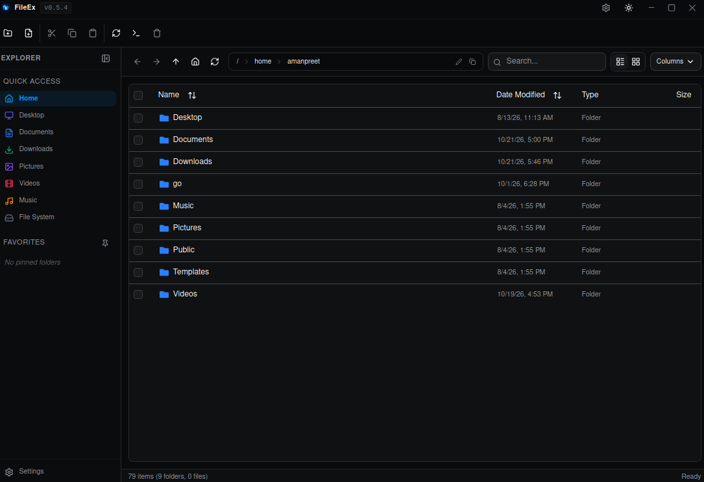
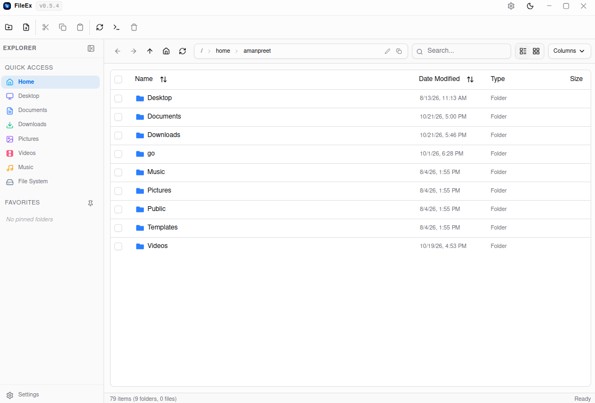

# FileEx - Modern File Explorer

<div align="center">
  
  <br/><br/>

  [](https://github.com/Amanbig/fileEx/releases)
  [](https://tauri.app/)
  [](https://react.dev/)
  [](https://www.typescriptlang.org/)
  [](https://tailwindcss.com/)
  [](LICENSE)

  <p align="center">
    A fast, lightweight, and modern cross-platform desktop file explorer built with <b>Tauri 2</b>, <b>React 19</b>, <b>Rust</b>, and <b>shadcn/ui</b>.
  </p>
</div>

---

## 📸 Screenshots

<div align="center">
  <table>
    <tr>
      <td align="center">
        
        <br/>
        <sub><b>Light Theme</b></sub>
      </td>
      <td align="center">
        
        <br/>
        <sub><b>Dark Theme</b></sub>
      </td>
    </tr>
  </table>
</div>

---

## ✨ Features at a Glance

### 🛡️ Error Handling & Crash Resilience
- **Global React Error Boundary**: Intercepts unhandled errors gracefully, rendering an informative recovery screen with **"Reload FileEx"** and **"Reset to Home"** options rather than crashing into a blank white screen.
- **Strict Filename Validation**: Pre-validates file and folder names on both frontend and backend to block empty inputs, illegal slashes (`/`, `\`), null bytes (`\0`), and Windows-forbidden characters (`< > : " | ? *`).
- **Circular Copy & Move Protection**: Prevents infinite recursion when a user attempts to copy or move a folder into itself or its own subdirectories.
- **Duplicate Copy Auto-Naming**: Automatically creates non-conflicting names (e.g. `document (copy).pdf`, `photos (copy 2)`) when pasting duplicate files in the same folder.
- **Cross-Filesystem Move Resilience**: Gracefully handles partition-crossing moves (`EXDEV: Cross-device link`) with an automated copy + source cleanup fallback.
- **Human-Readable OS Error Reasons**: Formats raw I/O errors into actionable user notifications (e.g. `"Permission denied. Check write permissions."`).

### 🎨 Ambient Window Shadow & Visual Polish
- **Native Desktop Window Shadow**: Enabled via Tauri's `"shadow": true` window configuration.
- **Dynamic Window Shell**: Restored/floating mode renders a crisp 1px border (`border border-border/80 dark:border-white/15`) and deep ambient shadow (`shadow-[0_12px_40px_rgba(0,0,0,0.18)] dark:shadow-[0_20px_60px_rgba(0,0,0,0.85)]`), while maximized mode automatically fits edge-to-edge.
- **Distinct Surface Hierarchy**: Clean visual distinction between the main canvas, sidebar with rightward-casting shadow, elevated toolbars, and recessed pill breadcrumbs address bar.
- **High-Contrast Hover & Focus States**: TitleBar close button highlights in vivid red (`hover:!bg-red-500 hover:!text-white dark:hover:!bg-red-600 dark:hover:!text-white`), and all window controls and toolbar buttons feature high-contrast overlays on hover and keyboard navigation.

### 🚀 In-App Updater & Smart Package Manager
- **Live GitHub Releases Checking**: One-click check from the Settings drawer for the latest official release.
- **Optimized Background Checking**: Runs silently on launch (throttled to once every 6 hours via local storage cache) without slowing down app startup or triggering API rate limits.
- **Notification Dot Badge**: Visual update indicators appear on TitleBar and Sidebar settings buttons when an update is available.
- **Smart OS & Architecture Matching**:
  - **Linux**: Matches `.deb` (Debian/Ubuntu), `.AppImage`, or `.rpm` for `x86_64` / `aarch64`.
  - **Windows**: Matches `.msi` or `.exe` installer binaries.
  - **macOS**: Matches `.dmg` Apple Silicon or Intel disk images.
- **Download Streaming with Live Progress**: Displays real-time download percentage, megabytes transferred, and speed.
- **Elevated Permissions Handling**:
  - For Linux `.deb` packages, triggers native system Polkit authentication via `pkexec apt-get install -y` with automatic fallback to software managers.
  - For `.AppImage` packages, sets executable permissions (`chmod 0755`) and executes immediately.
  - For Windows & macOS, directly executes installers seamlessly.

### 💻 Integrated Terminal Launcher
- **Instant Terminal Opening**: Launch an external terminal directly inside any selected directory or current canvas.
- **Three Access Points**: Top toolbar action button, canvas right-click context menu, and folder context menu.
- **Cross-Platform Auto-Detection**:
  - **Linux**: Prioritizes `$TERMINAL`, `x-terminal-emulator`, `gnome-terminal`, `ptyxis`, `konsole`, `xfce4-terminal`, `kitty`, `alacritty`, `foot`, `tilix`.
  - **Windows**: Launches Windows Terminal (`wt -d`), PowerShell, or `cmd.exe`.
  - **macOS**: Launches native `Terminal.app` (`open -a Terminal`).

### ⚙️ Full Customization Settings
- **Slide-Over Settings Drawer**: Accessible via `Ctrl+,`, TitleBar gear, or Sidebar settings button.
- **Themes**: Switch between Light, Dark, or System mode with harmonious neutral-slate styling.
- **Typography & Font Sizing**: Choose Small (13px), Medium (14px), or Large (16px) with dynamic UI scaling; toggle between System Sans, Monospace, and Elegant Serif typefaces.
- **Explorer Navigation**: Configurable Single-Click or Double-Click folder navigation.
- **Hidden Files Toggle**: Show or hide system dotfiles (`.git`, `.config`, etc.) with a single click.
- **Merged About & Updates**: View system info, app version, release notes, license, and update status in one clean screen.

### 🗂️ Dual View Modes
- **Details Table View**: High-density sortable table with responsive layout (`Name` takes all available width, with compact columns for `Date Modified`, `Type`, and `Size`).
- **Cards Grid View**: Rich visual grid with large colored file-type icons, file names, and human-readable sizes with card hover elevation.
- **Persistent View Preference**: Remembers your preferred view layout across app sessions.

### 📌 Places Sidebar & Pinned Favorites
- **Quick Access Places**: Quick one-click navigation to Home, Desktop, Documents, Downloads, Pictures, Videos, Music, and Root filesystem.
- **Custom Favorites**: Pin and unpin any folder to your favorites list with persistent storage.
- **Collapsible Mode**: Compact sidebar toggle to maximize browsing workspace.

### 🧭 Interactive Breadcrumb Navigation
- **Clickable Breadcrumb Path**: Click any segment of the path to jump directly to parent directories.
- **Click-to-Edit Address Bar**: Click on the breadcrumb background to type or paste direct paths.
- **History & Parent Navigation**: Dedicated Back (`Alt+Left`), Forward (`Alt+Right`), and Up-one-level (`Alt+Up`) buttons.

### 🖱️ Context Menus & Global Keyboard Shortcuts
- **Right-Click Context Menus**:
  - **Files & Folders**: Open, Open in Terminal, Copy, Cut, Copy Path, Copy Name, Rename, Properties, Delete.
  - **Empty Canvas**: Create New Folder, Create New File, Paste, Refresh, Open Terminal Here.
- **Native Modal Dialogs**:
  - Inline rename modal with intelligent filename stem pre-selection (preserving extension).
  - Destructive deletion confirmation dialog.
  - Comprehensive File/Folder Properties Inspector displaying file size, Unix permissions, dates, and directory item counts.
- **Global Desktop Hotkeys**:

| Shortcut | Action |
|:---|:---|
| <kbd>Ctrl</kbd> + <kbd>C</kbd> | Copy selected items to clipboard |
| <kbd>Ctrl</kbd> + <kbd>X</kbd> | Cut selected items to clipboard |
| <kbd>Ctrl</kbd> + <kbd>V</kbd> | Paste items from clipboard |
| <kbd>Ctrl</kbd> + <kbd>A</kbd> | Select all items in current directory |
| <kbd>Ctrl</kbd> + <kbd>,</kbd> | Open Settings drawer |
| <kbd>F2</kbd> | Rename selected item |
| <kbd>Delete</kbd> | Delete selected item(s) |
| <kbd>Enter</kbd> | Open selected folder or launch file |
| <kbd>Alt</kbd> + <kbd>←</kbd> | Navigate Back in history |
| <kbd>Alt</kbd> + <kbd>→</kbd> | Navigate Forward in history |
| <kbd>Alt</kbd> + <kbd>↑</kbd> | Navigate Up one level (`..`) |
| <kbd>Esc</kbd> | Clear selection / close dialogs |

---

## 🚀 Quick Start

### Prerequisites
- [Node.js](https://nodejs.org/) (v18 or higher)
- [Rust](https://rustup.rs/) (latest stable)
- [Git](https://git-scm.com/)

#### Linux System Packages (Debian/Ubuntu)
```bash
sudo apt update
sudo apt install -y libwebkit2gtk-4.1-dev libappindicator3-dev librsvg2-dev patchelf
```

### Installation & Run

1. **Clone the repository**
   ```bash
   git clone https://github.com/Amanbig/fileEx.git
   cd fileEx
   ```

2. **Install dependencies**
   ```bash
   npm install
   ```

3. **Start development server**
   ```bash
   npm run tauri dev
   ```

4. **Build production executable**
   ```bash
   npm run tauri build
   ```

---

## 🛠️ Technology Stack

| Layer | Technologies |
|:---|:---|
| **Frontend Framework** | [React 19](https://react.dev/) + [TypeScript 5](https://www.typescriptlang.org/) |
| **Desktop Framework** | [Tauri 2.0](https://tauri.app/) (Rust 2021) |
| **Bundler & Tooling** | [Vite 7](https://vitejs.dev/) |
| **Styling & Design** | [Tailwind CSS 4](https://tailwindcss.com/) + CSS Variables |
| **UI Components** | [shadcn/ui](https://ui.shadcn.com/) + [Radix UI](https://www.radix-ui.com/) |
| **Table & Sorting** | [TanStack Table v8](https://tanstack.com/table) |
| **Icons & Feedback** | [Lucide React](https://lucide.dev/) + [Sonner Toasts](https://sonner.emilkowal.ski/) |
| **Rust Backend Crates**| `tauri`, `serde`, `tokio`, `reqwest`, `dirs`, `chrono`, `open` |

---

## 📁 Project Structure

```
fileEx/
├── .github/                       # GitHub configurations
│   ├── ISSUE_TEMPLATE/            # Interactive issue forms (Bug report, Feature request)
│   │   ├── bug_report.yml
│   │   ├── feature_request.yml
│   │   └── config.yml
│   ├── workflows/                 # CI/CD release automation
│   │   └── release.yml
│   └── PULL_REQUEST_TEMPLATE.md   # Standard pull request template
├── src/                           # React 19 Frontend
│   ├── components/
│   │   ├── app/
│   │   │   ├── commandsPallet.tsx       # Breadcrumbs, history, view toggle & actions
│   │   │   ├── deleteModal.tsx          # Confirm delete modal dialog
│   │   │   ├── fileGrid.tsx             # Responsive card grid view component
│   │   │   ├── fileStructure.tsx        # Main explorer controller & TanStack table view
│   │   │   ├── placesSidebar.tsx        # System places & pinned favorites sidebar
│   │   │   ├── propertiesModal.tsx      # File & folder properties inspector
│   │   │   ├── renameModal.tsx          # Rename modal with smart stem selection
│   │   │   ├── settingsModal.tsx        # Settings slide-over drawer
│   │   │   ├── settingsUpdatesTab.tsx   # In-app updater & release manager
│   │   │   ├── themeToggle.tsx          # Quick theme switcher
│   │   │   └── titleBar.tsx             # Frameless title bar with native window controls
│   │   ├── ui/                          # shadcn/ui base primitives
│   │   ├── errorBoundary.tsx            # Global application crash recovery boundary
│   │   └── themeProvider.tsx            # Theme provider context
│   ├── hooks/
│   │   ├── useAppSettings.tsx           # App customization state & persistent settings
│   │   └── useAppUpdateCheck.ts         # Silent background update checker
│   ├── lib/
│   │   └── utils.ts                     # Utility helpers (formatting, class merging)
│   ├── App.css                          # Modern neutral-slate styling & design tokens
│   ├── App.tsx                          # App root with Settings & Theme providers
│   └── main.tsx                         # React entry point with ErrorBoundary & WindowShell
├── src-tauri/                     # Rust Desktop Backend
│   ├── src/
│   │   ├── lib.rs                       # Tauri commands (file I/O, updater, terminal launcher)
│   │   └── main.rs                      # Tauri runtime entry point
│   ├── Cargo.toml                       # Rust dependencies
│   ├── tauri.conf.json                  # Tauri configuration & window settings
│   └── icons/                           # Application branding icons
├── releases/                      # Changelogs & detailed release notes
│   ├── v0.1.0.md
│   ├── v0.5.4.md
│   ├── v0.6.0.md
│   └── v0.6.1.md
├── CODE_OF_CONDUCT.md             # Contributor Covenant Code of Conduct
├── CONTRIBUTING.md                # Development & contribution guidelines
├── LICENSE                        # MIT License
├── package.json                   # Frontend dependencies & scripts
├── README.md                      # Project documentation
├── RELEASE_NOTES.md               # Complete release changelog
└── SECURITY.md                    # Security vulnerability policy
```

---

## 🔌 Tauri Backend Commands

FileEx communicates between React and Rust via high-performance Tauri IPC commands:

| Command | Description |
|:---|:---|
| `get_current_directory` | Resolves the initial working directory |
| `get_home_directory` | Resolves user's home directory across Linux, macOS, and Windows |
| `get_system_places` | Detects standard directories (Desktop, Documents, Downloads, Music, Pictures, Videos, Root) |
| `list_directory(path)` | Efficiently lists all files and directories with metadata (size, dates, type, permissions) |
| `navigate_to_path(path)` | Validates and resolves directory paths |
| `create_folder(path, name)` | Validates name and creates a new folder safely |
| `create_file(path, name)` | Validates name and creates a new empty file |
| `delete_item(path)` | Clears readonly permissions and deletes item recursively |
| `rename_item(old_path, new_name)`| Validates name and renames a file or folder |
| `copy_items(sources, dest)` | Prevents circular recursion, handles duplicate auto-naming, and copies recursively |
| `move_items(sources, dest)` | Prevents circular moves, falls back to copy+remove on cross-device links (`EXDEV`) |
| `open_file_with_default_app` | Launches a file in the system default application |
| `open_terminal(path)` | Spawns an external terminal instance at the specified directory path |
| `get_item_properties(path)` | Gathers comprehensive metadata (byte size, dates, counts, Unix mode) |
| `get_install_info` | Detects OS platform, architecture, and current package installation format |
| `download_update_file` | Streams release binaries from GitHub with live progress feedback |
| `install_update_package` | Runs the package installer (`pkexec apt` for `.deb`, `chmod` for AppImage, `open` for DMG/MSI) |

---

## 🤝 Contributing

Contributions, issues, and feature requests are welcome!
Please read our [Contributing Guidelines](CONTRIBUTING.md) and [Code of Conduct](CODE_OF_CONDUCT.md) before submitting pull requests.

1. Fork the repository
2. Create your feature branch (`git checkout -b feat/amazing-feature`)
3. Commit your changes (`git commit -m 'feat: add amazing feature'`)
4. Push to the branch (`git push origin feat/amazing-feature`)
5. Open a Pull Request using our [PR Template](.github/PULL_REQUEST_TEMPLATE.md)

---

## 🔒 Security

For security vulnerabilities and disclosures, please refer to our [Security Policy](SECURITY.md).

---

## 📄 License

This project is open-source software licensed under the [MIT License](LICENSE).

---

<div align="center">
  <b>Built with ❤️ using Tauri, React, and Rust</b>
</div>
